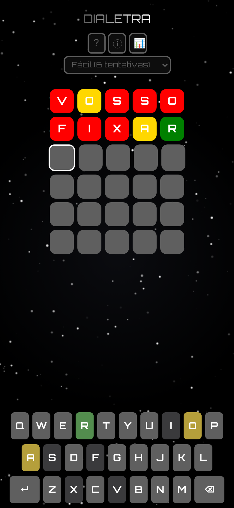
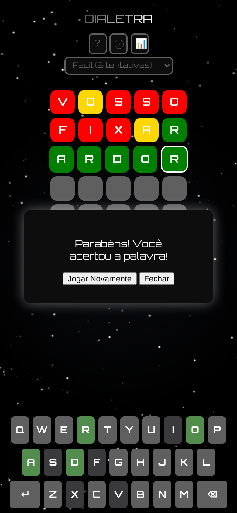

<p align="center">
  
</p>

<p align="center">
  Descubra a palavra secreta de 5 letras. Inspirado no <a href="https://term.ooo/">Termo</a> e no <a href="https://www.nytimes.com/games/wordle/index.html">Wordle</a>.
</p>

<p align="center">
  
  
  
</p>

---

## Telas

<table>
  <tr>
    <td align="center"><br><sub>Partida em andamento</sub></td>
    <td align="center"><br><sub>Acertou a palavra</sub></td>
  </tr>
</table>

## Como jogar

Você tem algumas tentativas para descobrir a palavra. Depois de cada palpite, as letras mudam de cor:

- 🟩 **Verde:** a letra está na palavra e no lugar certo
- 🟨 **Amarelo:** a letra está na palavra, mas em outro lugar
- 🟥 **Vermelho:** a letra não está na palavra

A palavra pode ter letras repetidas, como em *amada*.

## Funcionalidades

- Três níveis: fácil (6 tentativas), médio (5) e difícil (4)
- Mais de 1.100 palavras secretas, todas comuns, e mais de 18 mil palavras aceitas como palpite, com plurais e conjugações
- Teclado na tela que mostra as letras já usadas, e o teclado do computador aceita letras com acento
- Letras que viram uma por uma ao revelar o palpite
- Estatísticas salvas no navegador: partidas, vitórias, sequências e acertos por tentativa
- Botão para compartilhar o resultado em quadradinhos coloridos, sem entregar a palavra
- Sons gerados pelo próprio navegador, com botão para desligar
- Funciona no celular e no computador
- Fundo animado de estrelas, desenhado com Canvas

## Como rodar

Não precisa instalar nada. Baixe o repositório e abra o `index.html` no navegador:

```bash
git clone https://github.com/henryco-meneghetti/Dialetra.git
```

Aberto direto do computador, o jogo aceita como palpite só as palavras secretas, porque o navegador bloqueia a leitura de `dados/palpites.txt`. Para testar com a lista completa, rode um servidor local na pasta do projeto, por exemplo com o Live Server do VS Code ou com:

```bash
python -m http.server
```

e abra `http://localhost:8000`.

## Palavras

- `script/palavras.js`: as palavras secretas, escolhidas para serem conhecidas
- `dados/palpites.txt`: todas as palavras de 5 letras aceitas como palpite, uma por linha

A lista de palpites vem do dicionário do corretor ortográfico do LibreOffice. Para gerar de novo, use `ferramentas/gerar_palpites.py`. As fontes e licenças estão em [`dados/CREDITOS.md`](dados/CREDITOS.md).

## Tecnologias

HTML, CSS e JavaScript puro, sem bibliotecas. O fundo usa a API Canvas e as estatísticas ficam no `localStorage`.

## Autor

Feito por [Henryco Meneghetti](https://www.linkedin.com/in/henryco-meneghetti-1659b035b/).
